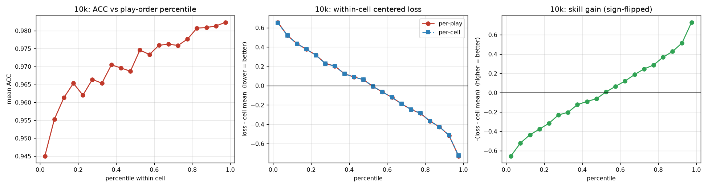
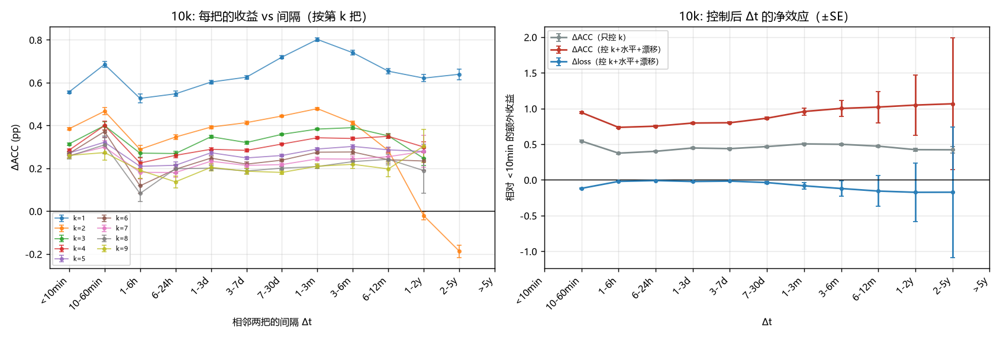

# DenseConstantRegressor

从 osu!mania 4K 游玩记录中学习**谱面难度潜向量**。

Learning **beatmap difficulty vectors** from osu!mania 4K play records.

[中文](#中文) · [English](#english)

---

## 中文

### 简介

把每条游玩记录看成 `(玩家, 谱面) → loss`，先学这个低秩回归，再把学到的**谱面向量**当作难度特征，
用于回归官方 star。数据来自 osu! 官方 [data.ppy.sh](https://data.ppy.sh/) dump 的 osu!mania 4K 成绩。

三步管线，**一个入口、一个 YAML、一个实验目录**；每个 step 可以有多个版本：

| 步骤 | 默认版本 | 产物 |
|---|---|---|
| **0 预处理** | `step0/preprocess` → `scripts/step0_preprocess.py` | play 表（5 列）+ 谱面元数据（17 列） |
| **1 划分+清洗** | `step1/clean` → `scripts/step1_clean.py` | play 表 + `split` 列（train/test/dropped） |
| **2 预测** | `step2/predict` → `scripts/step2_predict.py` | 玩家/谱面潜向量 + 指标 |
| **3 定数回归** | *未实现* | — |

### 快速开始

```bash
pip install -r requirements.txt

# 下载数据（约 14 GB，不入库）
cd data/raw
curl -LO https://data.ppy.sh/2026_09_01_performance_mania_top_1000.tar.bz2
curl -LO https://data.ppy.sh/2026_09_01_performance_mania_top_10000.tar.bz2
tar -xjf 2026_09_01_performance_mania_top_1000.tar.bz2  -C extracted/
tar -xjf 2026_09_01_performance_mania_top_10000.tar.bz2 -C extracted_10k/
cd ../..

# 跑实验：一个 YAML = 一次实验 = 一个 experiments_{时间戳}/ 目录
python main.py -c configs/exp_full_1k.yaml    # 从 dump 全流程（step0 → step1 → step2）
python main.py -c configs/exp_std_1k.yaml     # 复用 data/processed 的缓存，只跑 step2
python main.py -c configs/exp_cm3p_1k.yaml    # step2 + CM3P 内容向量

# 参数扫描：不改脚本、不用记长参数
python main.py -c configs/exp_std_1k.yaml --set name=dim32 --set steps.step2.params.dim=32

# 先看要跑什么（不建目录、不执行）
python main.py -c configs/exp_full_1k.yaml --dry-run
```

每次运行都会新建 `experiments_{时间戳}[_{name}]/`：`config.yaml`（参数快照）、`logs/`、
`artifacts/`（中间文件）、`results/`（结果）、`manifest.json`（每步的命令行/耗时/输入输出
指纹/指标）、`run.sh`（可重放的等价命令）。完整说明见
[docs/procedure.md](docs/procedure.md)。

### 结果速览

测试集为 30% 的 `(玩家, 谱面)` 有序对，指标为 loss 的 RMSE / Spearman：

| 模型 | 1k RMSE | 1k Spearman | 10k RMSE | 10k Spearman |
|---|---|---|---|---|
| bias | 1.5236 | 0.7330 | 1.3727 | 0.6874 |
| mf_dot | 1.4548 | 0.7632 | 1.3327 | 0.7079 |
| **mirt** | **1.4582** | **0.7633** | **1.3331** | **0.7096** |

<p align="center">
  
  
</p>

### 目录结构

```
main.py       唯一入口：读 configs/*.yaml，按 step 调用 scripts/ 下的程序
dcr/          编排包：配置解析 / 实验目录 / step 注册表 / 流水线 / 子进程执行
configs/      实验配置 —— 一个 YAML = 一次实验
scripts/      35 个当前脚本（step 的实现在这里）+ legacy/ 60 个退役脚本（旧 v2 管线）
docs/         技术文档（procedure.md 是流程与编排说明）+ archive/ 归档 + figs/ 图
logs/         26 份历史运行日志（新日志写在各自实验目录里）
manifests/    全量白名单 id 清单 + CM3P 远程任务清单 + 256×512 探针夹具（约 2 MB，入库）
experiments_*/ 每次实验的参数快照、日志、中间文件与结果（不入库）
data/         仅目录骨架 —— 约 14 GB 实际数据不入库
```

### 文档

| 文档 | 内容 |
|---|---|
| [docs/procedure.md](docs/procedure.md) | **流程与编排**：main.py / YAML 字段 / 实验目录 / step 版本 / 扩展方式 |
| [docs/step0_preprocessing.md](docs/step0_preprocessing.md) | 预处理：dump 结构、mod 策略、标签口径 |
| [docs/step1_cleaning.md](docs/step1_cleaning.md) | 清洗：两条行级删除 |
| [docs/step2_prediction.md](docs/step2_prediction.md) | 预测：模型族、消融、9 条校验 |
| [docs/archive/play_order_analysis.md](docs/archive/play_order_analysis.md) | 学习曲线（归档） |
| [docs/archive/learning_rate_heterogeneity.md](docs/archive/learning_rate_heterogeneity.md) | 学习率异质性（归档） |
| [docs/archive/forgetting_curve.md](docs/archive/forgetting_curve.md) | 遗忘曲线（归档） |
| [docs/archive/practice_vs_time.md](docs/archive/practice_vs_time.md) | 练习 vs 日历时间（归档） |
| [docs/archive/cleaning_plan.md](docs/archive/cleaning_plan.md) | 清洗方案与修订记录（归档） |
| [docs/archive/beatmap_embedding_plan.md](docs/archive/beatmap_embedding_plan.md) | 谱面嵌入规划（归档） |
| [docs/cm3p_step2_integration_plan.md](docs/cm3p_step2_integration_plan.md) | **CM3P 接入 step2（v2）**：冻结内容向量 + 纯点积，管线与 transformer 解耦 |
| [docs/cm3p_step2_results.md](docs/cm3p_step2_results.md) | **CM3P 接入实测**：内容 vs 1-hot、`d` 扫描、真实时间漂移消融 |
| [docs/step2_capacity_dim_sweep.md](docs/step2_capacity_dim_sweep.md) | **维度扫描与容量诊断**：自由低秩 K 的真实上限、稀疏谱面筛选对照、内容锚定 FM 对照、可辨识性 |
| [docs/cm3p_remote_runbook.md](docs/cm3p_remote_runbook.md) | **远程执行手册**：把全量白名单谱面缓存成 `.osu`（只有正文）→ 推理 CM3P 向量 → 混用探针 → 合并 → 更新白名单表 |
| [docs/cm3p_hpc_slurm.md](docs/cm3p_hpc_slurm.md) | **HPC / Slurm 手册**：文件夹上传 + Slurm 队列下的执行方式（`scripts/slurm/*.slurm`） |

### 说明

* **数据不入库**：原始 dump 与中间产物约 14 GB，只保留 `data/` 目录骨架（`.gitkeep`）。
* **`external/bobert` 不入库**：那是 [token03/bobert](https://github.com/token03/bobert) 的独立克隆，
  需要时自行 `git clone` 到该路径。
* 依赖见 [requirements.txt](requirements.txt)，开发环境 Python 3.13；CM3P 推理（`step0c --source osu-dir`）是另一套 GPU 侧环境，见 [requirements-cm3p.txt](requirements-cm3p.txt)（含 `hydra-core`）。

### 许可

本仓库未附许可证文件。

---

## English

### Overview

Treat each play as `(player, beatmap) → loss`, fit that low-rank regression first, then use the
learned **beatmap vectors** as difficulty features to regress the official star rating.
Data comes from the official [data.ppy.sh](https://data.ppy.sh/) dumps of osu!mania 4K scores.

Three steps, **one entry point, one YAML, one experiment directory**; every step may have
several versions:

| Step | Default version | Artifact |
|---|---|---|
| **0 Preprocess** | `step0/preprocess` → `scripts/step0_preprocess.py` | play table (5 cols) + beatmap metadata (17 cols) |
| **1 Split + clean** | `step1/clean` → `scripts/step1_clean.py` | play table + a `split` column (train/test/dropped) |
| **2 Predict** | `step2/predict` → `scripts/step2_predict.py` | player/beatmap latent vectors + metrics |
| **3 Constant regression** | *not implemented* | — |

### Quick start

```bash
pip install -r requirements.txt

# Download the data (~14 GB, not tracked)
cd data/raw
curl -LO https://data.ppy.sh/2026_09_01_performance_mania_top_1000.tar.bz2
curl -LO https://data.ppy.sh/2026_09_01_performance_mania_top_10000.tar.bz2
tar -xjf 2026_09_01_performance_mania_top_1000.tar.bz2  -C extracted/
tar -xjf 2026_09_01_performance_mania_top_10000.tar.bz2 -C extracted_10k/
cd ../..

# Run an experiment: one YAML = one run = one experiments_{timestamp}/ directory
python main.py -c configs/exp_full_1k.yaml    # dump -> step0 -> step1 -> step2
python main.py -c configs/exp_std_1k.yaml     # reuse data/processed, run step2 only
python main.py -c configs/exp_cm3p_1k.yaml    # step2 with CM3P content vectors

# Parameter sweeps without editing scripts or retyping long flags
python main.py -c configs/exp_std_1k.yaml --set name=dim32 --set steps.step2.params.dim=32

# Show what would run (creates nothing)
python main.py -c configs/exp_full_1k.yaml --dry-run
```

Each run creates `experiments_{timestamp}[_{name}]/` holding `config.yaml` (resolved
parameters), `logs/`, `artifacts/` (intermediates), `results/`, `manifest.json` (per-step
command line, timings, input/output fingerprints, metrics) and `run.sh` (replayable
commands). See [docs/procedure.md](docs/procedure.md).

### Results at a glance

The test set is 30% of the `(player, beatmap)` ordered pairs; metrics are RMSE / Spearman on loss:

| Model | 1k RMSE | 1k Spearman | 10k RMSE | 10k Spearman |
|---|---|---|---|---|
| bias | 1.5236 | 0.7330 | 1.3727 | 0.6874 |
| mf_dot | 1.4548 | 0.7632 | 1.3327 | 0.7079 |
| **mirt** | **1.4582** | **0.7633** | **1.3331** | **0.7096** |

<p align="center">
  
  
</p>

### Repository layout

```
main.py       the single entry point: reads configs/*.yaml, calls scripts/ step by step
dcr/          orchestration package: config, experiment dir, step registry, pipeline, runner
configs/      experiment configs — one YAML = one experiment
scripts/      35 current scripts (the step implementations) + legacy/ 60 retired ones
docs/         technical documents (procedure.md covers the pipeline) + archive/ + figs/
logs/         26 historical run logs (new logs live inside each experiment directory)
manifests/    the full whitelist manifest + CM3P remote-run lists + a 256x512 probe fixture (~2 MB, tracked)
experiments_*/ per-run config snapshot, logs, intermediates and results (untracked)
data/         directory skeleton only — the ~14 GB of actual data is not tracked
```

### Documentation

| Document | Contents |
|---|---|
| [docs/procedure.md](docs/procedure.md) | **Pipeline and orchestration**: main.py, YAML fields, experiment directory, step versions, extending |
| [docs/step0_preprocessing.md](docs/step0_preprocessing.md) | Preprocessing: dump layout, mod policy, label semantics |
| [docs/step1_cleaning.md](docs/step1_cleaning.md) | Cleaning: the two row-level deletions |
| [docs/step2_prediction.md](docs/step2_prediction.md) | Prediction: model family, ablations, the 9 checks |
| [docs/archive/play_order_analysis.md](docs/archive/play_order_analysis.md) | Learning curve (archived) |
| [docs/archive/learning_rate_heterogeneity.md](docs/archive/learning_rate_heterogeneity.md) | Learning-rate heterogeneity (archived) |
| [docs/archive/forgetting_curve.md](docs/archive/forgetting_curve.md) | Forgetting curve (archived) |
| [docs/archive/practice_vs_time.md](docs/archive/practice_vs_time.md) | Practice vs calendar time (archived) |
| [docs/archive/cleaning_plan.md](docs/archive/cleaning_plan.md) | Cleaning design and revision record (archived) |
| [docs/archive/beatmap_embedding_plan.md](docs/archive/beatmap_embedding_plan.md) | Beatmap embedding plan (archived) |
| [docs/cm3p_step2_integration_plan.md](docs/cm3p_step2_integration_plan.md) | **Wiring CM3P into step2 (v2)**: frozen content vector + plain dot product, decoupled from the transformer run |
| [docs/cm3p_step2_results.md](docs/cm3p_step2_results.md) | **CM3P wiring, measured**: content vs 1-hot, dimension sweep, real-time drift ablation |
| [docs/cm3p_remote_runbook.md](docs/cm3p_remote_runbook.md) | **Remote runbook**: cache every whitelist chart as `.osu` text, run CM3P, mix probe, merge, rebuild the whitelist table |
| [docs/cm3p_hpc_slurm.md](docs/cm3p_hpc_slurm.md) | **HPC / Slurm runbook**: folder upload + `sbatch` submission (`scripts/slurm/*.slurm`) |
| [docs/step2_capacity_dim_sweep.md](docs/step2_capacity_dim_sweep.md) | **Dimension sweep and capacity diagnosis**: the real ceiling of free low-rank K, sparse-chart filter control, content-anchored FM control, identifiability |

### Notes

* **No data is tracked**: the raw dumps and intermediate artifacts total ~14 GB; only the `data/`
  skeleton is kept (`.gitkeep`).
* **`external/bobert` is not tracked**: it is a standalone clone of
  [token03/bobert](https://github.com/token03/bobert) — `git clone` it there yourself if needed.
* Dependencies are in [requirements.txt](requirements.txt); developed on Python 3.13. The CM3P embed path (`step0c --source osu-dir`) is a separate GPU-side environment — see [requirements-cm3p.txt](requirements-cm3p.txt) (it carries `hydra-core`).

### License

This repository ships no license file.
